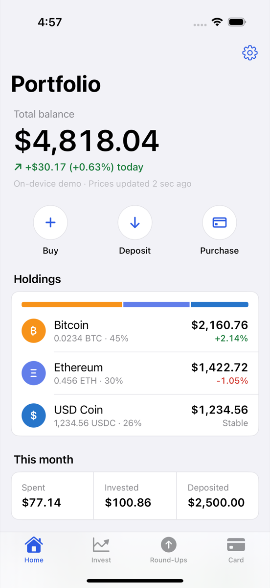
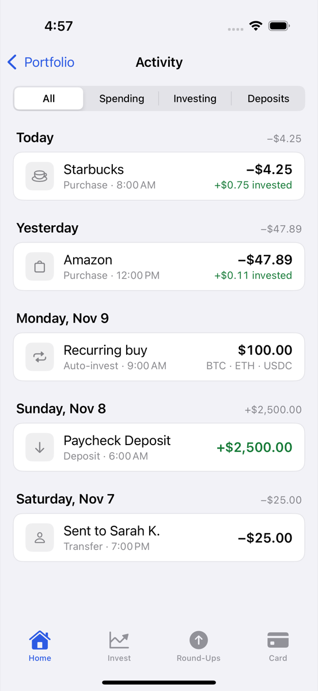
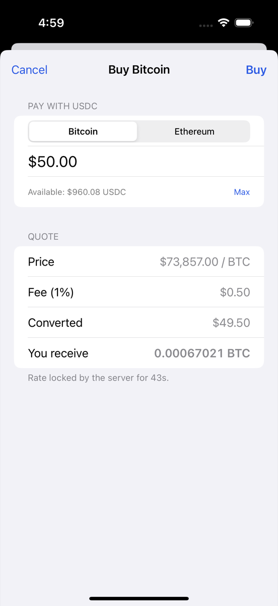
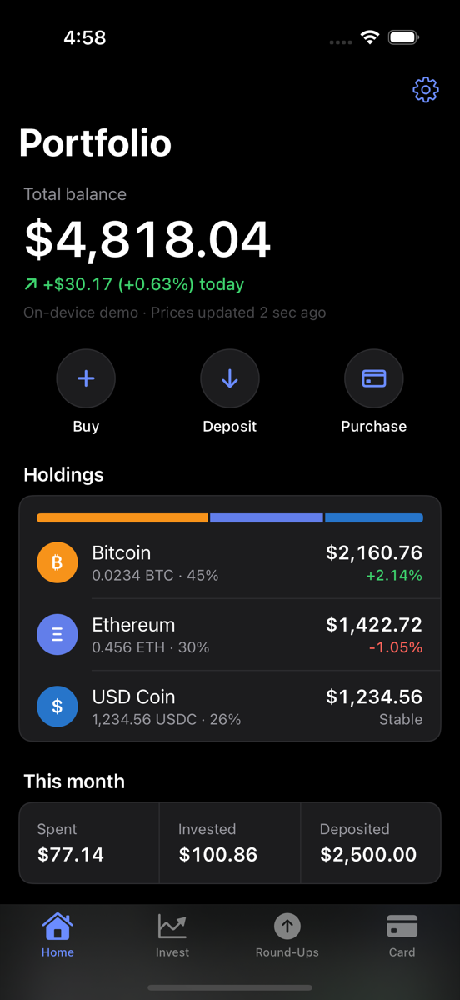

<div align="center">

# 🐸 CrypToad

**A crypto-linked debit card app concept — turn paychecks into crypto, spend it anywhere, and invest your spare change.**

[](https://github.com/Sardeen07/CrypToad/actions/workflows/ci.yml)


</div>

---

## Overview

CrypToad is an iOS app concept that connects everyday spending with
cryptocurrency investing. Your paycheck lands in USDC (a dollar-pegged
stablecoin), you spend it with a debit card, and every purchase is rounded up
with the spare change invested into BTC, ETH, or USDC.

The repo has three parts:

| Part | What it is |
|---|---|
| [`CrypToad/`](CrypToad) | SwiftUI iOS app |
| [`CrypToadCore/`](CrypToadCore) | Swift package with all the money logic, fully unit-tested |
| [`backend/`](backend) | FastAPI + PostgreSQL API: accounts, round-ups, DCA, trades, and Plaid bank linking on a double-entry ledger |

Signed out, the app runs entirely on the device. **Sign in** (with Apple, or a one-tap demo
account) and every purchase, round-up, DCA buy, and trade runs on the backend's ledger instead,
and the app shows the server's balances and history.

> ⚠️ **Prototype:** market prices are real (CoinGecko) and bank linking uses Plaid's real API
> (Sandbox), but balances, the card, and trades are simulated. No real money or crypto moves. See
> [What's built vs. planned](#whats-built-vs-planned).

<p align="center">
  
  
  
  
</p>

## Features

- **Accounts** — Sign in with Apple (identity token verified server-side, with a nonce against replay) or a one-tap demo account; session token kept in the Keychain; sign out and delete account
- **Server sync** — signed in, balances, history, round-up settings, and card freeze live on the backend; the app caches them for offline viewing
- **Bank round-ups (Plaid)** — link a bank (Plaid Sandbox), and its purchases are rounded up and invested, Acorns-style; each bank transaction is rounded up at most once
- **Live portfolio** — BTC/ETH prices and 24h change from CoinGecko, refreshed every minute and on pull-to-refresh, with offline fallback to the last known prices
- **Round-up investing** — every card purchase rounds up to the next dollar; the spare change actually buys BTC/ETH at live prices, split by your allocation. Optional 2×/3×/5× multiplier
- **Allocation editor** — sliders that always total 100%, plus presets (Balanced, Aggressive Bitcoin, Stablecoin Saver)
- **Dollar-cost averaging** — set amount and frequency; scheduled buys run automatically, including ones missed while the app was closed
- **Buy BTC / ETH with USDC** — live quote with a 1% fee breakdown before you confirm
- **Card controls** — freeze the card (blocks purchases) and reveal the PIN behind Face ID
- **Face ID app lock** — locks when the app leaves the screen
- **Saved locally** — everything persists between launches
- **Transaction history** — filter by spending, investing, or deposits

## Engineering highlights

- **125 automated tests.** 66 Swift tests cover money math, round-ups, allocations, DCA scheduling, trades, persistence, and the API client; 58 backend tests cover Sign in with Apple, the ledger, round-ups, DCA, trades, and Plaid sync (against a fake Plaid); and a UI test drives the real app against a running backend: demo sign-in → card swipe → server-quoted BTC buy → sign out.
- **Money is `Decimal`, never `Double`.** Floating point can't represent values like $0.10 exactly. `Decimal.exact("47.89")` avoids even the float-literal trap (`let x: Decimal = 47.89` is actually 47.89000000000000512).
- **No lost cents.** Splitting $0.75 across 50/30/20 rounds each share down, then gives leftover cents to the largest weight, so shares always add up exactly. A test checks this for thousands of amounts.
- **Failed operations change nothing.** Ledger operations validate funds, prices, and card state *before* touching balances. The store applies them to a copy and only commits on success.
- **Logic is separate from UI.** `CrypToadCore` has no SwiftUI dependency, so the same tests run on macOS and Linux in CI.
- **Double-entry backend.** Every trade is a journal entry that nets to zero per asset; amounts are stored as integer minor units; row locks, single-use quotes, and idempotency keys prevent double spending. See [`backend/README.md`](backend/README.md).
- **Retries can't double-buy.** Trades use the quote id as the idempotency key; scheduled DCA buys use their schedule date, so a retry, a crash, or a second device never buys twice. Bank round-ups are keyed by Plaid's transaction id.
- **A real design system.** Colors, type, spacing, radii, and components are tokens in [`Theme.swift`](CrypToad/Support/Theme.swift) ([design notes](docs/design.md)): native light/dark mode, one brand color, financial colors reserved for meaning, WCAG AA contrast, Dynamic Type up to accessibility sizes, and an iPad layout. A UI test tours every screen in light, dark, and large text.
- **Secrets stay secret.** Session tokens are stored only as SHA-256 hashes on the server and in the Keychain on the device; Plaid access tokens are encrypted at rest.

## What's built vs. planned

| Area | Status |
|---|---|
| SwiftUI app: home, round-ups, DCA, card, history, trade, settings | ✅ Built |
| Round-up, allocation, DCA, and trade logic (`CrypToadCore`) | ✅ Built + 53 tests |
| Live market prices (CoinGecko) | ✅ Built |
| Local persistence | ✅ Built |
| Face ID / Touch ID lock | ✅ Built |
| Backend API: quote, trade, history, PostgreSQL ledger | ✅ Built |
| Accounts: Sign in with Apple, demo accounts, sessions, account deletion | ✅ Built (Apple sign-in needs a paid developer team to run) |
| App ↔ backend connection (server mode) | ✅ Built + UI test |
| Server-side round-ups, DCA, card swipes, activity feed | ✅ Built |
| Bank linking + round-ups via Plaid | ✅ Built (Sandbox) |
| One-click deploy (Render Blueprint) | ✅ Config ready |
| CI (GitHub Actions) | ✅ Built |
| Plaid Link UI (real banks), KYC, card issuing, crypto custody | 🔲 Planned — production needs licensed partners |

## Tech Stack

**iOS:** Swift, SwiftUI, Observation (`@Observable`), async/await, AuthenticationServices (Sign in with Apple), Keychain, LocalAuthentication, XCUITest, XcodeGen
**Core:** Swift package, XCTest
**Backend:** Python 3.12, FastAPI, SQLAlchemy 2, PostgreSQL, PyJWT, pytest, Docker, Render
**Data & partners:** CoinGecko public API, Plaid (Sandbox)

## Getting Started

### Requirements

- macOS with **Xcode 15** or later
- iOS 17 simulator or device

### Run the app

```bash
brew install xcodegen
git clone https://github.com/Sardeen07/CrypToad.git
cd CrypToad
xcodegen generate
open CrypToad.xcodeproj
```

Pick an iPhone simulator and press **⌘R**.

> Face ID in the simulator: **Features → Face ID → Enrolled**, then
> **Features → Face ID → Matching Face** when prompted.

### Run the tests

```bash
swift test --package-path CrypToadCore     # 66 Swift tests (macOS or Linux)
cd backend && pip install -r requirements-dev.txt && pytest   # 58 API tests

# End-to-end UI test (needs the backend running on localhost:8000; skipped otherwise)
xcodebuild test -project CrypToad.xcodeproj -scheme CrypToad \
  -destination 'platform=iOS Simulator,name=iPhone 16 Pro'
```

### Run the backend

```bash
cd backend
docker compose up --build
open http://localhost:8000/docs
```

Then in the app: **⚙️ → Try a demo account**. The app talks to `http://localhost:8000` by
default; change the **Server** field in Settings to point at a deployed backend.

### Turn on bank linking (Plaid Sandbox)

1. Create a free account at [dashboard.plaid.com](https://dashboard.plaid.com/signup) and copy your **Sandbox** keys.
2. `cp backend/.env.example backend/.env` and paste them in (`.env` is git-ignored).
3. Restart the backend. In the app: **⚙️ → Bank → Link test bank**, then **Round up new purchases**.

### Deploy the backend

[`render.yaml`](render.yaml) is a Render Blueprint: **Render → New → Blueprint → this repo** creates
the API and a PostgreSQL database (free plans), generates the encryption secret, and asks for the
Plaid keys. Put the resulting `https://….onrender.com` URL in the app's Server field (or in
`CRYPTOAD_SERVER_URL` in `project.yml` to make it the default).

### Turn on Sign in with Apple

Needs a paid Apple Developer team. In `project.yml`, set `DEVELOPMENT_TEAM` and uncomment
`CODE_SIGN_ENTITLEMENTS`, run `xcodegen generate`, and enable the Sign in with Apple capability for
`com.sardeen07.cryptoad` in the developer portal. Until then, use demo accounts.

### Try it

- **Home → Simulate Purchase** adds a random card purchase and invests its round-up at live prices.
- **Home → Buy BTC / ETH** shows a live quote with the fee before you confirm.
- **Round-Up → Customize Allocation** opens the sliders.
- **Invest → Buy Now** runs a DCA buy; **Edit Schedule** changes amount and frequency.
- **Card → Freeze Card**, then try a purchase.
- **⚙️ → Require Face ID**, then background the app.
- **⚙️ → Try a demo account**: the badge on Home switches to **Synced** and everything above now runs on the server. Buy BTC to see the server's rate-locked quote count down.

## Project Structure

```
CrypToad/
├── CrypToad/                      # iOS app
│   ├── App/
│   │   ├── CrypToadApp.swift      # Entry point, dependency setup
│   │   ├── PortfolioStore.swift   # @Observable store: on-device or server mode, sync, persistence
│   │   ├── KeychainStore.swift    # Session token storage
│   │   └── AppLock.swift          # Face ID / Touch ID
│   ├── Support/                   # Theme + formatting
│   └── Views/
│       ├── RootView.swift         # Lock screen overlay
│       ├── ContentView.swift      # Navigation + sheets
│       ├── Screens/               # Home, Round-Up, DCA, Card, History
│       ├── Sheets/                # Trade, Allocation editor, DCA schedule, Settings, Account + Bank
│       └── Components/
├── CrypToadCore/                  # Swift package (no UI)
│   ├── Sources/CrypToadCore/
│   │   ├── Money.swift            # Decimal helpers
│   │   ├── RoundUp.swift
│   │   ├── Allocation.swift       # Splitting + slider rebalancing
│   │   ├── PortfolioState.swift   # Ledger: purchases, DCA, trades, valuation
│   │   ├── Trading.swift          # Quotes + fees
│   │   ├── Prices.swift / CoinGeckoPriceService.swift
│   │   ├── Persistence.swift
│   │   └── API/                   # CrypToadAPI client + server models
│   └── Tests/CrypToadCoreTests/
├── CrypToadUITests/               # End-to-end test against a running backend + screen tour
├── backend/                       # FastAPI + PostgreSQL
├── docs/                          # Architecture, API spec, security, roadmap
├── scripts/screenshot.sh
├── render.yaml                    # One-click backend deploy (Render Blueprint)
└── project.yml                    # XcodeGen spec
```

## How Round-Ups Work

1. You buy a coffee for **$4.25** with the CrypToad card.
2. The purchase rounds up to **$5.00**.
3. The **$0.75** difference is split by your allocation: 50/30/20 → $0.38 BTC, $0.22 ETH, $0.15 USDC.
4. The BTC and ETH shares are bought at the current price (e.g. $0.38 ÷ $92,340 = 0.00000411 BTC).
5. In production, round-ups would be batched daily or weekly to reduce fees.

## Documentation

- [Architecture](docs/architecture.md)
- [API Specification](docs/api-spec.md) · [Backend README](backend/README.md)
- [Security Design](docs/security.md)
- [Roadmap](docs/roadmap.md)

## Disclaimer

CrypToad is a personal/educational project. It is not a licensed financial
product, does not hold or move real funds, and nothing in it is financial
advice. A production version would require money transmitter licensing,
KYC/AML compliance, and partnerships with a licensed card issuer and crypto
custodian. Price data provided by [CoinGecko](https://www.coingecko.com).

## Author

**Ali** — Computer Science @ UT Dallas
GitHub: [@Sardeen07](https://github.com/Sardeen07)

## License

[MIT](LICENSE)
